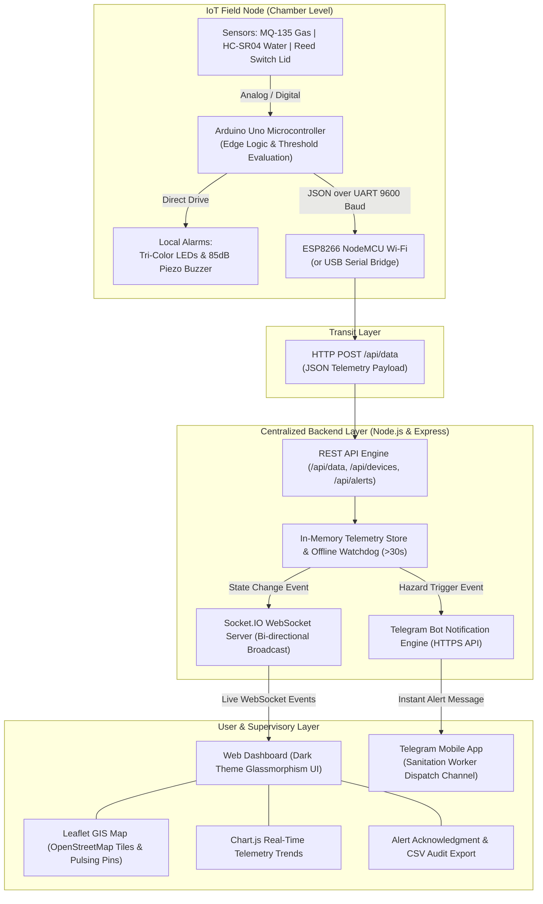

# 🏗️ System Architecture & Dataflow

The **Smart Manhole Guardian System** is structured as an end-to-end multi-tier IoT and telemetry platform designed for municipal utility safety and sanitation worker protection.

---

## 📐 High-Level Architecture Diagram



---

## 🔄 End-to-End Data Lifecycle

### 1. Edge Sampling & Assessment
* **Cycle**: Every 1.5 seconds, the Arduino Uno samples the MQ-135 gas sensor (analog A0), computes distance via HC-SR04 ultrasonic echo (digital D9/D10), and inspects the reed switch (digital D2).
* **Local State Machine**:
  * **SAFE**: Green LED ON. Buzzer OFF.
  * **WARNING**: Yellow LED ON. Intermittent beep pattern (200ms ON / 800ms OFF).
  * **DANGER**: Red LED ON. Continuous piercing buzzer (85 dB).

### 2. Telemetry Serialization
* The Uno serializes telemetry into a JSON payload:
  ```json
  {
    "deviceId": "MH-101",
    "name": "Connaught Place Sector 1",
    "lat": 28.6328,
    "lng": 77.2197,
    "gas": 620,
    "water": 45,
    "lidOpen": false,
    "status": "DANGER"
  }
  ```

### 3. Ingestion & Storage Pipeline
* The ESP8266 transmits an `HTTP POST` request to `/api/data`.
* The Express server parses the telemetry and stores it in the `DataStore`:
  * Updates current status for device `MH-101`.
  * Appends reading to the rolling 100-sample telemetry buffer.
  * Checks if device transitioned into `WARNING` or `DANGER`. If so, creates a new alert record.

### 4. Real-Time Push & GIS Map Integration
* The server broadcasts events across active Socket.IO connections:
  * `sensor_update`: Delivered to all dashboard instances within milliseconds.
  * `device_list_update`: Re-sorts the device sidebar by severity.
  * `new_alert`: Triggers browser audio siren and red alert banner.
* Leaflet.js updates the marker on the map:
  * **Green pin**: Safe
  * **Yellow pin**: Warning
  * **Red pulsing pin**: Danger with radiating radar wave animation
  * **Grey pin**: Offline

### 5. Automated Telegram Emergency Alerts
* The `TelegramService` dispatches an instant formatted alert to the designated Telegram group or supervisor chat.
* **Cooldown Mechanism**: A 60-second cooldown per node prevents alert flooding while allowing severity escalations to break through immediately.
* **Recovery Message**: When conditions normalize back to SAFE, a confirmation message is automatically dispatched.

### 6. Offline Device Watchdog
* Every 5 seconds, the backend inspects all registered manholes.
* If any node fails to transmit for $\ge 30$ seconds, it is marked `OFFLINE`.
* The dashboard marks the node grey in both the sidebar and map.
