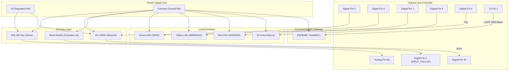

# 🔌 Circuit Diagram & Hardware Wiring Guide

The **Smart Manhole Guardian System** uses an **Arduino Uno R3** as the primary microcontroller node, reading gas, water level, and tamper switches, and transmitting telemetry via an **ESP8266 NodeMCU** (or USB Serial) to the centralized server.

---

## 📌 Master Pin Connection Table

| Subsystem | Sensor / Actuator Component | Arduino Uno Pin | Component Pin | Notes / Resistor Requirement |
| :--- | :--- | :--- | :--- | :--- |
| **Gas Detection** | MQ-135 Air Quality / Gas Sensor | **A0** | AOUT | Analog reading (0–1023 ADC) |
| | MQ-135 Power | **5V** | VCC | Needs 5V heater supply (~150mA) |
| | MQ-135 Ground | **GND** | GND | Common system ground |
| **Water Level** | HC-SR04 Ultrasonic Trigger | **Digital 9** | TRIG | 10µs trigger pulse output |
| | HC-SR04 Ultrasonic Echo | **Digital 10** | ECHO | Pulse width input |
| | HC-SR04 Power | **5V** | VCC | 5V supply |
| | HC-SR04 Ground | **GND** | GND | Common system ground |
| **Lid Tampering** | Magnetic Reed Switch / Limit | **Digital 2** | Terminal A | Uses `INPUT_PULLUP` internally |
| | Switch Ground Return | **GND** | Terminal B | LOW = Lid Closed, HIGH = Lid Open |
| **Visual Alarms** | Green LED (Status: SAFE) | **Digital 5** | Anode (+) | 220 $\Omega$ current-limiting resistor to GND |
| | Yellow LED (Status: WARNING) | **Digital 6** | Anode (+) | 220 $\Omega$ current-limiting resistor to GND |
| | Red LED (Status: DANGER) | **Digital 7** | Anode (+) | 220 $\Omega$ current-limiting resistor to GND |
| | All LED Cathodes (-) | **GND** | Cathode (-) | Common system ground |
| **Audible Alarm** | 5V Active Piezo Buzzer | **Digital 8** | Positive (+) | Direct digital drive or via 2N2222 NPN |
| | Piezo Buzzer Ground | **GND** | Negative (-) | Common system ground |
| **Wi-Fi Gateway** | ESP8266 NodeMCU (UART Rx) | **Digital 1 (TX)** | **D7 (GPIO 13)** | Level shifted or SoftwareSerial Rx |
| | Common Reference | **GND** | **GND** | **MANDATORY**: Common GND between Uno & ESP |

---

## 🗺️ Mermaid Circuit Wiring Diagram



---

## 🖨️ ASCII Schematic Diagram

```text
               +---------------------------------------------------+
               |                    ARDUINO UNO                    |
               |                                                   |
 [MQ-135]      |                                                   |
   VCC --------| +5V                                            A0 |<--- AOUT (Gas Level)
   GND --------| GND                                               |
               |                                                   |
 [HC-SR04]     |                                                   |
   VCC --------| +5V                                            D9 |---> TRIG (Pulse)
   GND --------| GND                                           D10 |<--- ECHO (Pulse Return)
               |                                                   |
 [Reed Switch] |                                                   |
   Terminal A -| GND                                            D2 |<--- Terminal B (INPUT_PULLUP)
               |                                                   |
 [Local Alert] |                                                   |
   Green LED <-| 220 Ohm Resistor <----------------------------- D5|
   Yellow LED<-| 220 Ohm Resistor <----------------------------- D6|
   Red LED <---| 220 Ohm Resistor <----------------------------- D7|
   Buzzer (+)<-| Direct / Transistor <-------------------------- D8|
   Buzzer (-) -| GND                                               |
               |                                                   |
 [ESP8266]     |                                                   |
   D7 (RX) <---| ---------------------------------------------- TX | (JSON Telemetry @ 9600)
   GND --------| GND (Common Ground)                               |
               +---------------------------------------------------+
```

---

## 💡 Practical Hardware Tips for Viva & Labs
1. **Common Ground is Crucial**: If powering the ESP8266 through USB and the Arduino through an adapter, connect a jumper between `GND` of Arduino and `GND` of ESP8266. Without this, serial data transmission will fail due to floating voltage references.
2. **MQ-135 Warm-Up Time**: The MQ-135 heating coil requires 2–3 minutes to stabilize. During the initial 60 seconds after power-up, analog readings will appear artificially elevated before settling to baseline.
3. **HC-SR04 Mounting**: Mount the ultrasonic sensor facing downwards from the inside of the manhole lid or top bracket. Ensure the ultrasonic cone has a clear line of sight to the water surface without acoustic reflections off the chamber walls.
